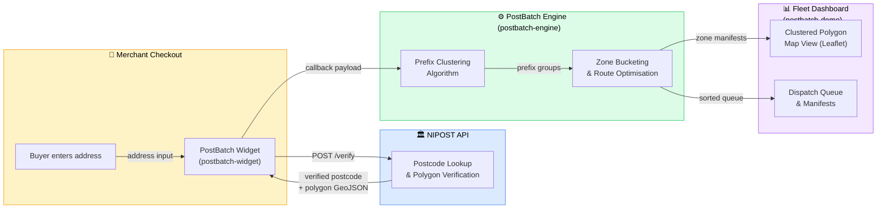

# PostBatch HQ

> **B2B Logistics Clustering Engine & Checkout SDK** — built on the [NIPOST Digital Postcode API](https://nipost.gov.ng).

PostBatch transforms last-mile delivery in Nigeria by giving every e-commerce checkout a verified NIPOST postcode and clustering parcels into optimised delivery zones *before* they leave the warehouse.

---

## What is PostBatch?

PostBatch is a two-part infrastructure product for logistics companies and merchants:

| Component | Role |
|---|---|
| **PostBatch Widget** | A lightweight `<script>` tag merchants drop into their checkout page. It captures and verifies the buyer's NIPOST postcode in real time. |
| **PostBatch Engine** | A server-side clustering algorithm that groups verified postcodes by their alphanumeric prefixes, bucketing parcels into delivery zones so fleet managers can sort in seconds, not hours. |

Together they eliminate address ambiguity, reduce failed deliveries, and cut morning warehouse sorting time by up to **90 %**.

---

## System Architecture



### Data Flow (Step-by-Step)

1. **Capture** — The buyer types their delivery address on the merchant's checkout page. The PostBatch Widget auto-suggests NIPOST postcodes as they type.
2. **Verify** — The Widget calls the NIPOST Digital Postcode API to validate the postcode and retrieve its delivery polygon (GeoJSON).
3. **Cluster** — The verified postcode is forwarded to the PostBatch Engine, which groups it with other pending parcels sharing the same alphanumeric prefix (e.g., all `LA-101-***` parcels fall into the *Lagos-Mainland Zone 1* bucket).
4. **Dispatch** — The Fleet Dashboard renders the clustered zones on a Leaflet map. The warehouse team scans the manifest, picks parcels by zone, and loads vehicles in a single pass.

---

## Repository Structure

```
postbatch-hq/
├── README.md                  ← You are here
├── package.json               ← Monorepo root (workspaces)
│
├── postbatch-widget/          ← Embeddable checkout widget
│   ├── index.js
│   ├── README.md              ← Merchant developer docs
│   └── package.json
│
├── postbatch-engine/          ← Server-side clustering logic
│   ├── cluster.js
│   ├── ARCHITECTURE.md        ← Sorting & bucketing deep-dive
│   └── package.json
│
└── postbatch-demo/            ← Saturday pitch demo app
    ├── index.html
    ├── App.jsx
    ├── PITCH_GUIDE.md         ← How to run the live demo
    ├── package.json
    ├── tailwind.config.js
    ├── postcss.config.js
    └── mock/
        └── postcodes.json     ← Fallback data for offline demos
```

---

## Quick Start

```bash
# Clone the repo
git clone https://github.com/postbatch/postbatch-hq.git
cd postbatch-hq

# Install all workspaces
npm install

# Run the demo
npm run demo
```

---

## Tech Stack

| Layer | Technology |
|---|---|
| Widget | Vanilla JS, Shadow DOM, CSS-in-JS |
| Engine | Node.js, Express, NIPOST API v2 |
| Demo | React 18, Vite, Tailwind CSS, Leaflet.js |
| Data | NIPOST Digital Postcode API, GeoJSON |

---

## Contributing

This is an early-stage startup repository. If you're part of the PostBatch team, please:

1. Branch from `main` using the pattern `feat/<feature-name>` or `fix/<bug-name>`.
2. Write tests for any Engine logic changes.
3. Update the relevant `README.md` or `ARCHITECTURE.md` when you change interfaces.

---

## License

**Proprietary** — © 2026 PostBatch Technologies Ltd. All rights reserved.
