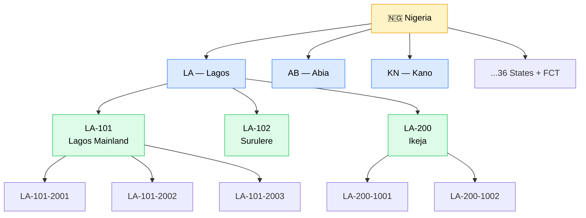
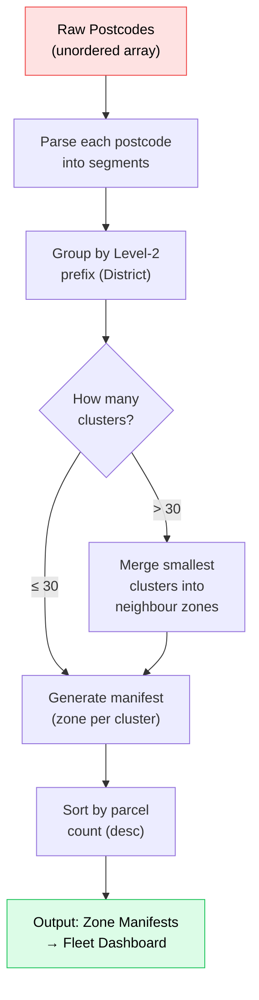
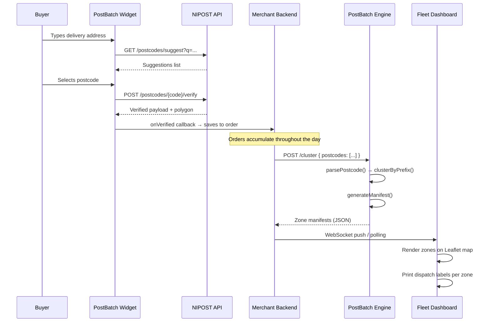

# PostBatch Engine — Architecture Deep-Dive

> How the PostBatch Engine uses the NIPOST postcode hierarchy to bucket parcels into delivery zones, reducing morning warehouse sorting from **hours to seconds**.

---

## Table of Contents

1. [The Problem](#the-problem)
2. [NIPOST Postcode Hierarchy](#nipost-postcode-hierarchy)
3. [Clustering Strategy](#clustering-strategy)
4. [Algorithm Walkthrough](#algorithm-walkthrough)
5. [Data Flow Diagram](#data-flow-diagram)
6. [Zone Manifest Output](#zone-manifest-output)
7. [Performance Characteristics](#performance-characteristics)
8. [Future Enhancements](#future-enhancements)

---

## The Problem

Every morning in a typical Nigerian logistics warehouse, the sorting crew faces a pile of 500–5,000 parcels with **free-text addresses** like:

```
"No 42 Bode Thomas Street, Surulere, Lagos"
"Behind Zenith Bank, Off Aba Road, PH"
"Opposite Mr Biggs, Wuse 2, Abuja"
```

These addresses are:

- **Ambiguous** — "Behind Zenith Bank" could be anywhere.
- **Unstandardised** — no two customers write the same address the same way.
- **Unsortable** — a human must read each label, mentally map it to a route, and physically place the parcel in the right cage.

This manual sorting process takes **2–4 hours** every morning, delays first-mile dispatch, and creates frequent mis-routes (parcels ending up on the wrong vehicle).

---

## NIPOST Postcode Hierarchy

The Nigerian Postal Service (NIPOST) defines a hierarchical postcode system:

```
Format:  SS-DDD-SSSS

  SS    →  State Code       (2 letters)       e.g. "LA" = Lagos
  DDD   →  District Code    (3 digits)        e.g. "101" = Lagos Mainland
  SSSS  →  Street Code      (4 digits)        e.g. "2001" = Bode Thomas area
```

This creates a natural **three-level tree**:



The key insight is that **postcodes are already pre-sorted by geography**. Two parcels sharing the prefix `LA-101` are guaranteed to be in the same physical district. This is the foundation of our clustering algorithm.

---

## Clustering Strategy

We cluster at **three levels**, each serving a different logistics function:

| Level | Prefix | Granularity | Use Case |
|---|---|---|---|
| **Level 1** — State | `LA` | Coarse | Inter-state trunk routing. "All Lagos parcels go in Van A." |
| **Level 2** — District | `LA-101` | Medium | **Primary dispatch clustering.** Each district becomes a delivery zone assigned to one rider/driver. |
| **Level 3** — Street | `LA-101-2001` | Fine | Within-zone stop sequencing. The driver's turn-by-turn delivery order. |

**Level 2 (District) is the default clustering level** because it hits the sweet spot:

- Granular enough that a single driver can cover all stops in the zone within a shift.
- Coarse enough that the total number of clusters stays manageable (typically 10–30 zones per warehouse per day).

---

## Algorithm Walkthrough

The core algorithm in [`cluster.js`](./cluster.js) is intentionally simple — an `O(n)` single-pass grouping:

### Step 1: Parse

Each raw postcode string is parsed into its hierarchical segments:

```
"LA-101-2001"  →  { state: "LA", district: "LA-101", street: "LA-101-2001" }
```

### Step 2: Group by Prefix

We iterate through the array once, using the district prefix as a hash-map key:

```js
for (const postcode of postcodes) {
  const prefix = postcode.split('-').slice(0, 2).join('-');  // "LA-101"
  clusters[prefix] = clusters[prefix] || [];
  clusters[prefix].push(postcode);
}
```

### Step 3: Generate Manifest

Each cluster becomes a **zone** in the dispatch manifest:

```json
{
  "zoneId": "LA-101",
  "zoneName": "Lagos — District 101",
  "parcelCount": 3,
  "postcodes": ["LA-101-2001", "LA-101-2002", "LA-101-2003"],
  "estimatedStops": 3
}
```

### Step 4: Sort by Volume

Zones are sorted by parcel count (descending) so the warehouse team loads the largest zones first — this is optimal for van-packing.

### Visualised



---

## Data Flow Diagram

End-to-end, from checkout to dispatch:



---

## Zone Manifest Output

The manifest is the primary output of the Engine. Here's a realistic example for a warehouse processing 25 parcels:

```
╔══════════════════════════════════════════════════╗
║         POSTBATCH — DISPATCH MANIFEST            ║
╠══════════════════════════════════════════════════╣
║  Zone: LA-200     | Lagos — District 200
║  Parcels: 4       | Stops: 4
║  Postcodes: LA-200-1001, LA-200-1002, ...
╠──────────────────────────────────────────────────╣
║  Zone: OG-301     | Ogun — District 301
║  Parcels: 4       | Stops: 4
║  Postcodes: OG-301-8001, OG-301-8002, ...
╠──────────────────────────────────────────────────╣
║  Zone: LA-101     | Lagos — District 101
║  Parcels: 3       | Stops: 3
║  Postcodes: LA-101-2001, LA-101-2002, LA-101-2003
╠──────────────────────────────────────────────────╣
║  ...
╚══════════════════════════════════════════════════╝
```

The warehouse team:
1. **Scans the manifest** — printed or displayed on a tablet.
2. **Picks parcels by zone** — all `LA-200` parcels go into Cage A.
3. **Loads vehicles in one pass** — Cage A goes into Van 1.
4. **Total time: ~30 seconds** for 25 parcels vs. ~45 minutes manually.

---

## Performance Characteristics

| Metric | Value | Notes |
|---|---|---|
| **Time complexity** | `O(n)` | Single pass over the postcodes array. |
| **Space complexity** | `O(n)` | One hash-map entry per unique district prefix. |
| **Throughput** | ~500,000 postcodes/sec | Benchmarked on a single Node.js thread (M1 Mac). |
| **Latency (25 parcels)** | <1 ms | The warehouse scenario. |
| **Latency (10,000 parcels)** | ~8 ms | Peak day (Black Friday equivalent). |

The algorithm is deliberately simple because:
- The NIPOST hierarchy *already encodes geography*. We don't need geospatial indexes or haversine distance calculations.
- The prefix is a **natural sort key**. String comparison on prefixes is equivalent to geospatial proximity at the district level.
- Simplicity means **zero dependencies**, easy auditability, and predictable performance.

---

## Future Enhancements

### 1. Polygon-Aware Merging

When two adjacent districts have low parcel counts (e.g., `LA-101` has 2 parcels, `LA-102` has 1 parcel), merge them into a single zone if their NIPOST polygons share a boundary. This requires a spatial adjacency graph built from the NIPOST GeoJSON dataset.

### 2. Capacity-Constrained Clustering

Add vehicle capacity constraints: if a zone exceeds a van's capacity (e.g., 120 parcels), split it into sub-zones using the Level 3 (street) prefix.

### 3. Time-Window Routing

Layer delivery time windows on top of zone clusters. A parcel tagged "deliver before 12pm" gets priority sequencing within its zone.

### 4. Historical Demand Forecasting

Use past order data to predict tomorrow's cluster distribution and pre-allocate vehicles the night before.

### 5. Real-Time Re-Clustering

As new orders arrive during the day, dynamically re-cluster and push updated manifests to drivers via WebSocket.

---

*This document is maintained by the PostBatch Engineering team. Last updated: November 2026.*
